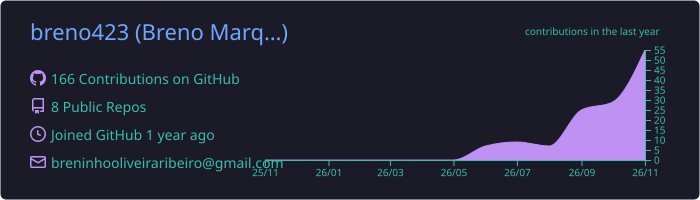
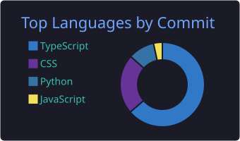
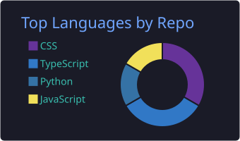
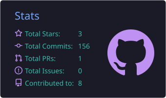
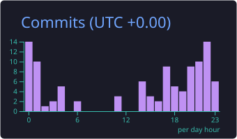

<h1 align="center">Olá, eu sou o Breno Marques 👋</h1>

  <b>Desenvolvedor Front-End | React · TypeScript · JavaScript | Foco em Cloud AWS ☁️</b> 
  Feira de Santana, Bahia 🇧🇷

  
  
  
  

---

## 🚀 Sobre mim

Estudante de Análise e Desenvolvimento de Sistemas, desenvolvo interfaces com **React** e **TypeScript** e estou direcionando minha carreira para **computação em nuvem**, com foco em **AWS**.

Gosto de construir aplicações web e levá-las até o deploy: da interface à infraestrutura que a coloca no ar.

- 🔭 Atualmente aprofundando em **AWS** (S3, CloudFront, Lambda, API Gateway, IAM) e **CI/CD**
- 🌱 Estudando arquitetura serverless e infraestrutura como código
- 💬 Pergunte-me sobre **React, TypeScript e deploy de aplicações web**
- 🎯 Aberto a oportunidades em **desenvolvimento web e cloud**

---

## 🛠️ Tecnologias

**Linguagens e front-end**

**Cloud e ferramentas**

---

## ☁️ Foco em nuvem

| Área | O que estou estudando / praticando |
| --- | --- |
| 🌐 Hospedagem | S3 + CloudFront com HTTPS e domínio próprio |
| ⚡ Serverless | Lambda, API Gateway, DynamoDB |
| 🔐 Segurança | IAM, princípio do menor privilégio |
| 🔁 Automação | CI/CD com GitHub Actions |

---

## 📊 Estatísticas do GitHub

  

  
  

  
  

  

---

  Obrigado por visitar meu perfil! ⭐

